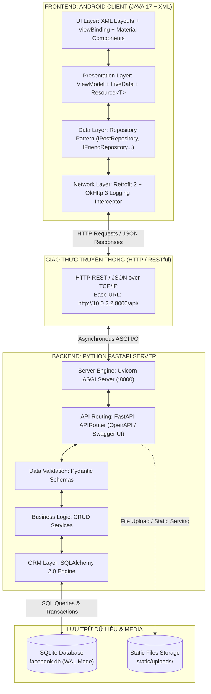
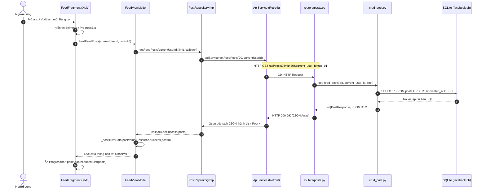
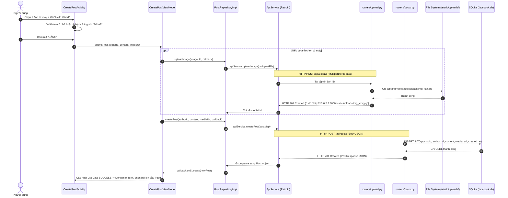
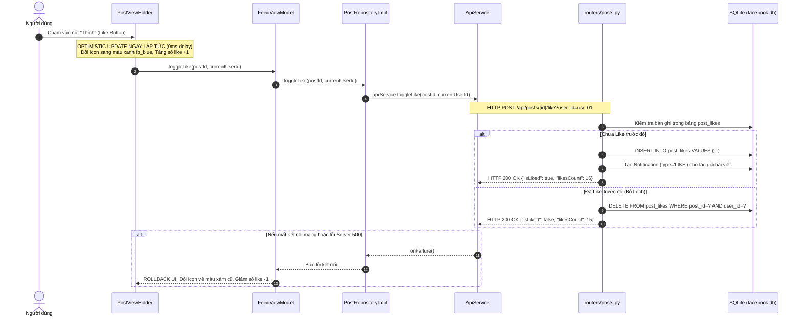

# 02. KIẾN TRÚC TOÀN DIỆN HỆ THỐNG: FRONTEND (ANDROID JAVA & XML) & BACKEND (PYTHON FASTAPI & SQLITE)

---

### 1. TỔNG QUAN KIẾN TRÚC TOÀN HỆ THỐNG (FULL-STACK MONOREPO ARCHITECTURE)

Hệ thống **Facebook Mobile Client** được tổ chức theo mô hình phân tách hoàn chỉnh giữa ứng dụng di động máy khách (**Frontend: Android Java 17 + XML**) và máy chủ dịch vụ (**Backend: Python FastAPI + SQLite**). Hai phần độc lập nhưng liên kết chặt chẽ qua giao thức chuẩn **RESTful API (JSON Payload)**:



---

## 2. SƠ ĐỒ TOÀN BỘ CÂY THƯ MỤC DỰ ÁN (PROJECT ROOT SOURCE TREE)

Dự án chứa đầy đủ mã nguồn Client và Server ngay trong cùng một kho lưu trữ:

```text
Facebook_Client/
│
├── .gitignore                          # Bỏ qua file build Gradle, .idea, __pycache__, venv
├── build.gradle                        # Top-level Gradle build configuration
├── settings.gradle                     # Khai báo module :app
├── gradle.properties                   # Cấu hình JVM memory cho Gradle
├── TODO.md                             # Bảng tiến độ 14 ngày của 7 thành viên
├── README.md                           # Hướng dẫn nhanh dự án
├── Mobile App.pdf                      # Tài liệu đặc tả yêu cầu gốc của đề tài
│
├── app/                                # PHẦN 1: FRONTEND ANDROID (JAVA 17 + XML)
│   ├── build.gradle                    # Dependencies: Retrofit, Glide, Material, ViewBinding
│   ├── proguard-rules.pro              # Quy tắc bảo vệ code
│   └── src/
│       ├── test/                       # Unit Tests JVM (JUnit 4, Mockito)
│       │   └── java/com/facebook/client/
│       │       ├── utils/
│       │       │   └── PostValidatorTest.java
│       │       └── features/feed/
│       │           └── CreatePostViewModelTest.java
│       │
│       └── main/
│           ├── AndroidManifest.xml     # Khai báo quyền INTERNET, Application & Activities
│           │
│           ├── java/com/facebook/client/
│           │   ├── MainActivity.java   # Activity chính gắn BottomNavigationView 4 tab
│           │   │
│           │   ├── core/               # Module dùng chung toàn hệ thống
│           │   │   ├── base/           # BaseActivity.java, BaseFragment.java
│           │   │   ├── common/         # Resource.java, Constants.java
│           │   │   ├── utils/          # PostValidator.java, DateUtils.java, ImageUtils.java
│           │   │   └── network/        # ApiClient.java, ApiService.java, ApiResponseHandler.java
│           │   │
│           │   ├── data/               # Quản lý dữ liệu tập trung
│           │   │   ├── model/          # DTOs: User.java, Post.java, Comment.java, Notification.java
│           │   │   ├── local/          # PreferenceManager.java (Lưu session User hiện tại)
│           │   │   └── repository/     # Repositories (Interface & Implementation)
│           │   │       ├── IPostRepository.java
│           │   │       ├── PostRepositoryImpl.java
│           │   │       ├── IFriendRepository.java
│           │   │       ├── FriendRepositoryImpl.java
│           │   │       ├── IProfileRepository.java
│           │   │       ├── ProfileRepositoryImpl.java
│           │   │       ├── INotificationRepository.java
│           │   │       └── NotificationRepositoryImpl.java
│           │   │
│           │   └── features/           # Chia nhỏ theo từng phân hệ (Feature Modules)
│           │       ├── auth/           # LoginActivity.java, AuthViewModel.java
│           │       ├── feed/           # FeedFragment.java, CreatePostActivity.java, FeedViewModel.java, PostAdapter.java
│           │       ├── comment/        # CommentBottomSheetDialog.java, CommentViewModel.java, CommentAdapter.java
│           │       ├── friends/        # FriendsFragment.java, SearchFriendsActivity.java, FriendsViewModel.java
│           │       ├── notifications/  # NotificationsFragment.java, NotificationViewModel.java, NotificationAdapter.java
│           │       └── profile/        # ProfileFragment.java, ProfileViewModel.java, PhotoGridAdapter.java
│           │
│           └── res/                    # TOÀN BỘ TÀI NGUYÊN GIAO DIỆN XML
│               ├── layout/             # Layout XML màn hình, thẻ bài viết, dialog
│               │   ├── activity_main.xml
│               │   ├── activity_login.xml
│               │   ├── activity_create_post.xml
│               │   ├── activity_search_friends.xml
│               │   ├── fragment_feed.xml
│               │   ├── fragment_friends.xml
│               │   ├── fragment_notifications.xml
│               │   ├── fragment_profile.xml
│               │   ├── fragment_profile_posts.xml
│               │   ├── fragment_profile_photos.xml
│               │   ├── bottom_sheet_comments.xml
│               │   ├── item_post.xml
│               │   ├── item_comment.xml
│               │   ├── item_friend_request.xml
│               │   ├── item_friend_list.xml
│               │   ├── item_notification.xml
│               │   └── item_photo_grid.xml
│               ├── drawable/           # Vector XML icons, selector, background
│               ├── values/             # colors.xml, strings.xml, dimens.xml, themes.xml
│               ├── navigation/         # main_navigation.xml (Jetpack Navigation Graph)
│               └── xml/                # network_security_config.xml (HTTP localhost)
│
├── backend/                            # PHẦN 2: BACKEND PYTHON FASTAPI + SQLITE
│   ├── main.py                         # FastAPI App, CORS, Static Mount, Routers
│   ├── database.py                     # Engine SQLite, WAL mode, SessionLocal, get_db
│   ├── models.py                       # SQLAlchemy ORM Models (User, Post, Comment, Like, Friend, Notif)
│   ├── schemas.py                      # Pydantic Schemas (Request/Response DTOs)
│   ├── seed_data.py                    # Script chèn sẵn dữ liệu mẫu vào facebook.db
│   ├── requirements.txt                # fastapi, uvicorn, sqlalchemy, pydantic, python-multipart
│   ├── facebook.db                     # Tệp tin CSDL SQLite (tự sinh khi chạy)
│   │
│   ├── crud/                           # Tầng truy vấn nghiệp vụ CSDL
│   │   ├── crud_user.py
│   │   ├── crud_post.py
│   │   ├── crud_comment.py
│   │   ├── crud_friend.py
│   │   └── crud_notif.py
│   │
│   ├── routers/                        # Tầng định tuyến Endpoints API
│   │   ├── auth.py
│   │   ├── posts.py
│   │   ├── comments.py
│   │   ├── friends.py
│   │   ├── profile.py
│   │   ├── notifications.py
│   │   └── upload.py
│   │
│   ├── static/
│   │   └── uploads/                    # Thư mục lưu trữ hình ảnh tải lên từ điện thoại
│   │
│   └── tests/                          # Kiểm thử tự động Backend với Pytest
│       ├── test_posts_api.py
│       └── test_likes_api.py
│
└── docs/                               # PHẦN 3: TOÀN BỘ 13 TÀI LIỆU KỸ THUẬT CHI TIẾT
    ├── INDEX.md
    ├── 01_OVERVIEW.md
    ├── 02_ARCHITECTURE.md              # Tài liệu kiến trúc toàn diện này
    ├── 03_DESIGN_SYSTEM.md
    ├── 04_USER_FLOW.md
    ├── 05_TEAM_ROLES_WORKLOAD.md
    ├── 06_TASKS_SPRINT_PLAN.md
    ├── 07_GIT_WORKFLOW_NAMING.md
    ├── 08_CODING_CONVENTION_DOCS.md
    ├── 09_BACKEND_SERVER.md
    ├── 10_TESTING_GUIDE.md
    ├── 11_BUG_TRIAGE_PROCESS.md
    └── 12_ENVIRONMENT_SETUP.md
```

---

## 3. CHI TIẾT CẤU TRÚC FRONTEND ANDROID (`app/` - JAVA & XML)

### 3.1. Phân Tầng Mã Nguồn Java (Clean Architecture + MVVM)
Mã nguồn Java được phân bổ chặt chẽ theo 4 tầng trách nhiệm:

#### 1. Presentation Layer (Tầng hiển thị):
- **Activities & Fragments:**
  - `MainActivity.java`: Điều hướng 4 tab chính thông qua `BottomNavigationView`.
  - `CreatePostActivity.java`: Màn hình soạn bài viết mới (bắt buộc có text hoặc ảnh mới mở khóa nút ĐĂNG).
  - `FeedFragment.java`: Hiển thị danh sách bài viết trang chủ, hỗ trợ kéo để làm mới (`SwipeRefreshLayout`).
  - `CommentBottomSheetDialog.java`: Hộp thoại bình luận text-only trượt từ đáy màn hình.
  - `FriendsFragment.java` & `SearchFriendsActivity.java`: Quản lý lời mời kết bạn và tìm kiếm bạn bè.
  - `ProfileFragment.java`: Màn hình cá nhân với Ảnh bìa, Avatar và TabLayout (Tab Posts & Tab Photos lưới 3 cột).
  - `NotificationsFragment.java`: Hiển thị danh sách thông báo tương tác.
- **Adapters & ViewHolders:**
  - `PostAdapter.java` & `PostViewHolder.java`: Tối ưu hiển thị danh sách bài viết cuộn mượt.
  - `CommentAdapter.java`: Hiển thị danh sách bình luận text-only.
  - `PhotoGridAdapter.java`: Hiển thị lưới ảnh tỷ lệ 1:1 bằng `GridLayoutManager(context, 3)`.
  - `FriendRequestAdapter.java` & `NotificationAdapter.java`.

#### 2. ViewModel Layer (Tầng điều phối trạng thái):
- `FeedViewModel.java`: Giữ `LiveData<Resource<List<Post>>>`, điều phối tải bài viết và thao tác Thích.
- `CreatePostViewModel.java`: Validate nội dung, upload ảnh và phát tín hiệu hoàn thành.
- `CommentViewModel.java`: Quản lý danh sách comment và gửi comment mới.
- `FriendsViewModel.java`: Quản lý lời mời kết bạn và tìm kiếm bạn bè (Debounce 300ms).
- `ProfileViewModel.java` & `NotificationViewModel.java`.
- **Đặc điểm sống còn:** ViewModel không bao giờ tham chiếu trực tiếp đến `Context`, `View`, `Button` để ngăn ngừa 100% rủi ro rò rỉ bộ nhớ (Memory Leak).

#### 3. Data & Networking Layer (Tầng dữ liệu):
- **Core Network Client:**
  - `ApiClient.java`: Khởi tạo `Retrofit` Singleton với `OkHttpClient` kèm `HttpLoggingInterceptor`.
  - `ApiService.java`: Khai báo toàn bộ các phương thức gọi HTTP (GET, POST, PUT, Multipart).
  - `ApiResponseHandler.java`: Bắt lỗi kết nối mạng (Timeout, Connection Refused) đóng gói vào `Resource.error()`.
- **Repositories:**
  - `IPostRepository.java` & `PostRepositoryImpl.java`: Gọi `ApiService` qua enqueue callback bất đồng bộ.
  - `IFriendRepository.java` & `FriendRepositoryImpl.java`.
  - `IProfileRepository.java` & `ProfileRepositoryImpl.java`.
  - `INotificationRepository.java` & `NotificationRepositoryImpl.java`.

---

### 3.2. Phân Tầng Tài Nguyên Giao Diện XML (`app/src/main/res/`)

#### 1. Danh mục các File Layout XML (`res/layout/`):
| File Layout XML | Thành phần giao diện đại diện | Cấu trúc thành phần chính bên trong |
|:--- |:--- |:--- |
| `activity_main.xml` | Khung ứng dụng chính | `CoordinatorLayout` + `FragmentContainerView` + `BottomNavigationView` (4 Tab) |
| `activity_create_post.xml` | Soạn bài viết mới | `Toolbar` (Nút Back, nút ĐĂNG), Header tác giả Public, `EditText` không viền, `ImageView` Preview ảnh, Bottom Toolbar (Nút thêm ảnh) |
| `fragment_feed.xml` | Bảng tin Home Feed | `SwipeRefreshLayout` + `RecyclerView` + Create Post Quickbox + `ProgressBar` |
| `item_post.xml` | Một thẻ bài viết trong Feed | `MaterialCardView` (Avatar, Tên tác giả, Thời gian, Nội dung text, `ImageView` bài viết, Thanh thống kê Like/Comment, 3 Nút: Thích, Bình luận, Chia sẻ) |
| `bottom_sheet_comments.xml` | Hộp thoại bình luận | `BottomSheet` trượt đáy + Header tiêu đề + `RecyclerView` bình luận + Ô nhập `EditText` bo tròn + Nút icon Gửi |
| `item_comment.xml` | Một dòng bình luận | Avatar nhỏ (32dp) + Bong bóng xám (`bg_comment_bubble`) chứa Tên in đậm và Nội dung chữ thuần túy (Text-only) |
| `fragment_friends.xml` | Tab Bạn bè | Ô tìm kiếm bạn bè + Mục "Lời mời kết bạn" (`RecyclerView`) + Mục "Bạn bè của bạn" |
| `item_friend_request.xml` | Một lời mời kết bạn | Avatar (60dp) + Tên người gửi + Cặp nút: Xanh "Chấp nhận" (`btn_confirm`) và Xám "Xóa" (`btn_delete`) |
| `fragment_profile.xml` | Trang cá nhân | Ảnh bìa (200dp), Avatar tròn (120dp) đè 50%, Tên người dùng, `TabLayout` + `ViewPager2` |
| `item_photo_grid.xml` | Ô ảnh trong kho ảnh Profile | `SquareImageView` (tỷ lệ 1:1, bo góc nhẹ) phục vụ hiển thị dạng lưới 3 cột |
| `item_notification.xml` | Dòng thông báo | Avatar + Icon loại tương tác + Nội dung thông báo + Thời gian tương đối + Trạng thái chưa đọc |

#### 2. Thư mục Giá trị XML (`res/values/`):
- `colors.xml`: Bảng màu chuẩn Facebook: `fb_blue` (`#1877F2`), `fb_background` (`#F0F2F5`), `fb_surface` (`#FFFFFF`), `fb_text_primary` (`#050505`), `fb_text_secondary` (`#65676B`).
- `dimens.xml`: Lưới khoảng cách 4dp, 8dp, 12dp, 16dp, 24dp; Cỡ chữ 12sp đến 22sp.
- `strings.xml`: Lưu toàn bộ nhãn văn bản tiếng Việt/Anh, nghiêm cấm hardcode chuỗi trực tiếp trong Java.
- `themes.xml`: Theme `Theme.MaterialComponents.DayNight.NoActionBar`.

#### 3. Cấu hình Quyền & Mạng (`AndroidManifest.xml` & `network_security_config.xml`):
Để máy ảo Android gọi được API `http://10.0.2.2:8000/api/` (giao thức HTTP cleartext không mã hóa SSL trong môi trường phát triển), Android bắt buộc phải có cấu hình an ninh mạng:
- File `app/src/main/res/xml/network_security_config.xml`:
  ```xml
  <?xml version="1.0" encoding="utf-8"?>
  <network-security-config>
      <domain-config cleartextTrafficPermitted="true">
          <domain includeSubdomains="true">10.0.2.2</domain>
          <domain includeSubdomains="true">localhost</domain>
      </domain-config>
  </network-security-config>
  ```
- File `app/src/main/AndroidManifest.xml`:
  ```xml
  <?xml version="1.0" encoding="utf-8"?>
  <manifest xmlns:android="http://schemas.android.com/apk/res/android">

      <!-- Quyền kết nối mạng và đọc bộ nhớ -->
      <uses-permission android:name="android.intent.action.INTERNET" />
      <uses-permission android:name="android.permission.INTERNET" />
      <uses-permission android:name="android.permission.ACCESS_NETWORK_STATE" />
      <uses-permission android:name="android.permission.READ_MEDIA_IMAGES" />

      <application
          android:allowBackup="true"
          android:icon="@mipmap/ic_launcher"
          android:label="Facebook"
          android:networkSecurityConfig="@xml/network_security_config"
          android:roundIcon="@mipmap/ic_launcher_round"
          android:supportsRtl="true"
          android:theme="@style/Theme.FacebookClient">

          <activity
              android:name=".MainActivity"
              android:exported="true"
              android:windowSoftInputMode="adjustPan">
              <intent-filter>
                  <action android:name="android.intent.action.MAIN" />
                  <category android:name="android.intent.category.LAUNCHER" />
              </intent-filter>
          </activity>

          <activity
              android:name=".features.feed.CreatePostActivity"
              android:exported="false"
              android:windowSoftInputMode="adjustResize" />

          <activity
              android:name=".features.friends.SearchFriendsActivity"
              android:exported="false" />

      </application>
  </manifest>
  ```

---

## 4. CHI TIẾT CẤU TRÚC BACKEND SERVER (`backend/` - PYTHON FASTAPI & SQLITE)

### 4.1. Kiến Trúc Phân Tầng Phía Server
Backend áp dụng kiến trúc chuẩn phân tách nghiệp vụ:
1. **Tầng Máy chủ (Server Engine):** `Uvicorn ASGI` lắng nghe cổng `8000`, xử lý I/O bất đồng bộ.
2. **Tầng Ứng dụng & Middleware (`main.py`):** Cấu hình CORS cho phép mọi IP truy cập, mount thư mục `/static/uploads/` để phục vụ hình ảnh tĩnh trực tiếp, đăng ký các routers phân hệ.
3. **Tầng Định tuyến API (`routers/`):**
   - Tiếp nhận HTTP Request.
   - Sử dụng **Pydantic Schemas** (`schemas.py`) tự động kiểm tra kiểu dữ liệu đầu vào.
   - Tự động sinh tài liệu OpenAPI tại đường dẫn `http://localhost:8000/docs`.
4. **Tầng Nghiệp vụ Dữ liệu (`crud/`):**
   - Chứa toàn bộ câu lệnh truy vấn CSDL thông qua SQLAlchemy Session.
   - Tách biệt hoàn toàn khỏi HTTP logic giúp dễ viết Unit Test với `pytest`.
5. **Tầng Cơ sở dữ liệu (`database.py` & `models.py`):**
   - Quản lý tệp tin `facebook.db`.
   - Kích hoạt **WAL Mode (Write-Ahead Logging)** cho SQLite:
     ```python
     @event.listens_for(engine, "connect")
     def set_sqlite_pragma(dbapi_connection, connection_record):
         cursor = dbapi_connection.cursor()
         cursor.execute("PRAGMA journal_mode=WAL;")
         cursor.execute("PRAGMA foreign_keys=ON;")
         cursor.close()
     ```
   - Điều này đảm bảo nhiều yêu cầu đọc (ví dụ lướt Feed) diễn ra đồng thời mà không bị khóa khi có yêu cầu ghi (ví dụ đăng bài hoặc thả like).

---

## 5. MẪU THIẾT KẾ & CODE THỰC CHIẾN MINH HỌA (JAVA, XML & PYTHON)

### 5.1. Mẫu Code Java Frontend: Retrofit API Service (`core/network/ApiService.java`)
```java
package com.facebook.client.core.network;

import com.facebook.client.data.model.Comment;
import com.facebook.client.data.model.Post;
import com.facebook.client.data.model.User;
import java.util.List;
import java.util.Map;
import okhttp3.MultipartBody;
import retrofit2.Call;
import retrofit2.http.*;

public interface ApiService {

    // 1. Phân hệ Feed & Bài viết
    @GET("posts")
    Call<List<Post>> getFeedPosts(
        @Query("limit") int limit,
        @Query("current_user_id") String currentUserId
    );

    @POST("posts")
    Call<Post> createPost(@Body Map<String, Object> body);

    @POST("posts/{id}/like")
    Call<Map<String, Object>> toggleLike(
        @Path("id") String postId,
        @Query("user_id") String userId
    );

    @POST("posts/{id}/share")
    Call<Post> sharePost(
        @Path("id") String postId,
        @Query("user_id") String userId
    );

    // 2. Phân hệ Bình luận (Text only)
    @GET("posts/{id}/comments")
    Call<List<Comment>> getComments(@Path("id") String postId);

    @POST("posts/{id}/comments")
    Call<Comment> addComment(
        @Path("id") String postId,
        @Body Map<String, String> body
    );

    // 3. Phân hệ Upload Ảnh tĩnh
    @Multipart
    @POST("upload")
    Call<Map<String, String>> uploadImage(@Part MultipartBody.Part file);

    // 4. Phân hệ Bạn bè & Profile
    @GET("users/{id}")
    Call<User> getUserProfile(@Path("id") String userId);

    @GET("users/{id}/posts")
    Call<List<Post>> getUserPosts(@Path("id") String userId);

    @GET("users/{id}/photos")
    Call<List<Post>> getUserPhotos(@Path("id") String userId);
}
```

---

### 5.2. Mẫu Layout XML Frontend: Thẻ Bài viết (`res/layout/item_post.xml`)
```xml
<?xml version="1.0" encoding="utf-8"?>
<com.google.android.material.card.MaterialCardView
    xmlns:android="http://schemas.android.com/apk/res/android"
    xmlns:app="http://schemas.android.com/apk/res-auto"
    android:id="@+id/cv_post_container"
    android:layout_width="match_parent"
    android:layout_height="wrap_content"
    android:layout_marginBottom="8dp"
    app:cardBackgroundColor="@color/fb_surface"
    app:cardCornerRadius="0dp"
    app:cardElevation="1dp"
    app:strokeWidth="0dp">

    <LinearLayout
        android:layout_width="match_parent"
        android:layout_height="wrap_content"
        android:orientation="vertical">

        <!-- HEADER: Avatar, Tên tác giả, Thời gian, Quyền riêng tư -->
        <LinearLayout
            android:layout_width="match_parent"
            android:layout_height="wrap_content"
            android:orientation="horizontal"
            android:gravity="center_vertical"
            android:padding="12dp">

            <ImageView
                android:id="@+id/iv_author_avatar"
                android:layout_width="40dp"
                android:layout_height="40dp"
                android:src="@drawable/bg_avatar_placeholder" />

            <LinearLayout
                android:layout_width="0dp"
                android:layout_height="wrap_content"
                android:layout_weight="1"
                android:layout_marginStart="10dp"
                android:orientation="vertical">

                <TextView
                    android:id="@+id/tv_author_name"
                    android:layout_width="wrap_content"
                    android:layout_height="wrap_content"
                    android:textColor="@color/fb_text_primary"
                    android:textSize="15sp"
                    android:textStyle="bold" />

                <LinearLayout
                    android:layout_width="wrap_content"
                    android:layout_height="wrap_content"
                    android:orientation="horizontal"
                    android:gravity="center_vertical">

                    <TextView
                        android:id="@+id/tv_post_time"
                        android:layout_width="wrap_content"
                        android:layout_height="wrap_content"
                        android:textColor="@color/fb_text_secondary"
                        android:textSize="12sp" />

                    <TextView
                        android:layout_width="wrap_content"
                        android:layout_height="wrap_content"
                        android:text=" • Public"
                        android:textColor="@color/fb_text_secondary"
                        android:textSize="10sp" />
                </LinearLayout>
            </LinearLayout>

            <ImageView
                android:id="@+id/iv_more_options"
                android:layout_width="24dp"
                android:layout_height="24dp"
                android:src="@drawable/ic_more_horiz" />
        </LinearLayout>

        <!-- BODY: Nội dung văn bản -->
        <TextView
            android:id="@+id/tv_post_content"
            android:layout_width="match_parent"
            android:layout_height="wrap_content"
            android:paddingStart="12dp"
            android:paddingEnd="12dp"
            android:paddingBottom="8dp"
            android:textColor="@color/fb_text_primary"
            android:textSize="15sp"
            android:lineSpacingExtra="3dp" />

        <!-- BODY: Hình ảnh đính kèm (nếu có) -->
        <ImageView
            android:id="@+id/iv_post_image"
            android:layout_width="match_parent"
            android:layout_height="wrap_content"
            android:adjustViewBounds="true"
            android:maxHeight="400dp"
            android:scaleType="centerCrop"
            android:visibility="gone" />

        <!-- STATS FOOTER: Số lượt thích & số bình luận -->
        <LinearLayout
            android:layout_width="match_parent"
            android:layout_height="wrap_content"
            android:orientation="horizontal"
            android:padding="10dp">

            <TextView
                android:id="@+id/tv_likes_count"
                android:layout_width="0dp"
                android:layout_height="wrap_content"
                android:layout_weight="1"
                android:text="0 lượt thích"
                android:textColor="@color/fb_text_secondary"
                android:textSize="12sp" />

            <TextView
                android:id="@+id/tv_comments_count"
                android:layout_width="wrap_content"
                android:layout_height="wrap_content"
                android:text="0 bình luận"
                android:textColor="@color/fb_text_secondary"
                android:textSize="12sp" />
        </LinearLayout>

        <View
            android:layout_width="match_parent"
            android:layout_height="1dp"
            android:background="@color/fb_divider_light" />

        <!-- ACTION BAR: Thích, Bình luận, Chia sẻ -->
        <LinearLayout
            android:layout_width="match_parent"
            android:layout_height="44dp"
            android:orientation="horizontal"
            android:weightSum="3">

            <LinearLayout
                android:id="@+id/layout_action_like"
                android:layout_width="0dp"
                android:layout_height="match_parent"
                android:layout_weight="1"
                android:gravity="center"
                android:clickable="true"
                android:focusable="true">
                <ImageView
                    android:id="@+id/iv_like_icon"
                    android:layout_width="20dp"
                    android:layout_height="20dp"
                    android:src="@drawable/ic_like_outline" />
                <TextView
                    android:id="@+id/tv_like_label"
                    android:layout_width="wrap_content"
                    android:layout_height="wrap_content"
                    android:layout_marginStart="6dp"
                    android:text="Thích"
                    android:textColor="@color/fb_action_gray"
                    android:textSize="13sp" />
            </LinearLayout>

            <LinearLayout
                android:id="@+id/layout_action_comment"
                android:layout_width="0dp"
                android:layout_height="match_parent"
                android:layout_weight="1"
                android:gravity="center"
                android:clickable="true"
                android:focusable="true">
                <ImageView
                    android:layout_width="20dp"
                    android:layout_height="20dp"
                    android:src="@drawable/ic_comment" />
                <TextView
                    android:layout_width="wrap_content"
                    android:layout_height="wrap_content"
                    android:layout_marginStart="6dp"
                    android:text="Bình luận"
                    android:textColor="@color/fb_action_gray"
                    android:textSize="13sp" />
            </LinearLayout>

            <LinearLayout
                android:id="@+id/layout_action_share"
                android:layout_width="0dp"
                android:layout_height="match_parent"
                android:layout_weight="1"
                android:gravity="center"
                android:clickable="true"
                android:focusable="true">
                <ImageView
                    android:layout_width="20dp"
                    android:layout_height="20dp"
                    android:src="@drawable/ic_share" />
                <TextView
                    android:layout_width="wrap_content"
                    android:layout_height="wrap_content"
                    android:layout_marginStart="6dp"
                    android:text="Chia sẻ"
                    android:textColor="@color/fb_action_gray"
                    android:textSize="13sp" />
            </LinearLayout>
        </LinearLayout>
    </LinearLayout>
</com.google.android.material.card.MaterialCardView>
```

---

### 5.3. Mẫu Code Python Backend: Router Bài viết (`routers/posts.py`)
```python
from fastapi import APIRouter, Depends, HTTPException, status, Query
from sqlalchemy.orm import Session
from typing import List, Optional
from database import get_db
import schemas
from crud import crud_post

router = APIRouter()

@router.get("", response_model=List[schemas.PostResponse])
def read_feed_posts(
    limit: int = Query(20, ge=1, le=100),
    current_user_id: Optional[str] = Query(None),
    db: Session = Depends(get_db)
):
    """Lấy danh sách bài viết trên Bảng tin kèm số lượt Like, Comment và cờ isLiked"""
    return crud_post.get_feed_posts(db, current_user_id=current_user_id, limit=limit)

@router.post("", response_model=schemas.PostResponse, status_code=status.HTTP_201_CREATED)
def create_new_post(
    post_in: schemas.PostCreate,
    db: Session = Depends(get_db)
):
    """Tạo bài viết mới (Ràng buộc: Bắt buộc có text hoặc ảnh)"""
    new_post = crud_post.create_post(db, post_in)
    return schemas.PostResponse(
        id=new_post.id,
        authorId=new_post.author.id,
        authorName=new_post.author.display_name,
        authorAvatar=new_post.author.avatar_url,
        content=new_post.content,
        mediaUrl=new_post.media_url,
        isPublic=new_post.is_public,
        likesCount=0,
        commentsCount=0,
        isLiked=False,
        createdAt=new_post.created_at
    )

@router.post("/{post_id}/like")
def toggle_like_post(
    post_id: str,
    user_id: str = Query(...),
    db: Session = Depends(get_db)
):
    """Toggle Like bài viết (chuyển đổi giữa thích và bỏ thích)"""
    return crud_post.toggle_like(db, post_id, user_id)
```

---

## 6. SƠ ĐỒ LUỒNG HOẠT ĐỘNG CHI TIẾT (END-TO-END FLOWS)

### 6.1. Luồng 1: Tải Bảng tin Home Feed (Feed Retrieval Flow)


---

### 6.2. Luồng 2: Tạo bài viết mới & Upload ảnh Multipart


---

### 6.3. Luồng 3: Tương tác Thích với Optimistic UI Update & Rollback


---

## 7. QUY TRÌNH SETUP HỆ THỐNG ĐỒNG BỘ (SYSTEM SETUP & EXECUTION)

### Bước 1: Khởi chạy Backend Python FastAPI
```bash
# 1. Di chuyển vào thư mục backend
cd backend

# 2. Tạo môi trường ảo và kích hoạt
python -m venv venv
.\venv\Scripts\Activate.ps1 # Trên Windows PowerShell
# source venv/bin/activate # Trên macOS/Linux

# 3. Cài đặt các thư viện cần thiết
pip install -r requirements.txt

# 4. Khởi tạo dữ liệu mẫu và chạy server
python seed_data.py
uvicorn main:app --reload --host 0.0.0.0 --port 8000
```
*Kiểm tra Swagger UI tài liệu API tại: `http://localhost:8000/docs`.*

### Bước 2: Khởi chạy Frontend Android trên Máy ảo Pixel 10a
1. Mở thư mục gốc `Facebook_Client` trong **Android Studio "Rabbit 1"**.
2. Kiểm tra Gradle JDK trỏ đúng **Java 17 LTS**.
3. Bấm **Sync Project with Gradle Files**.
4. Khởi động máy ảo chuẩn **Pixel 10a (API Level 37.2)**.
5. Bấm tổ hợp phím `Shift + F10` (hoặc nút Run ):
   - Ứng dụng tự động kết nối tới Backend thông qua Base URL `http://10.0.2.2:8000/api/`.
   - Bảng tin lập tức tải về các bài viết mẫu từ SQLite và hiển thị mượt mà!
