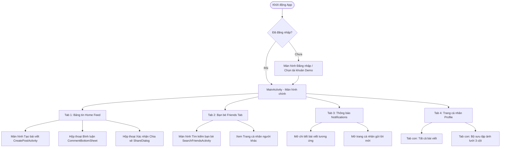
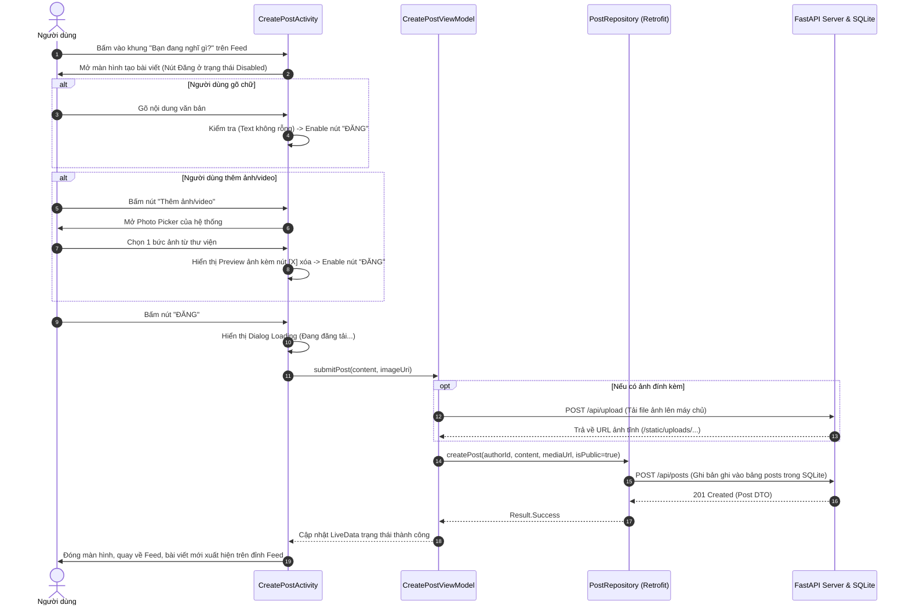
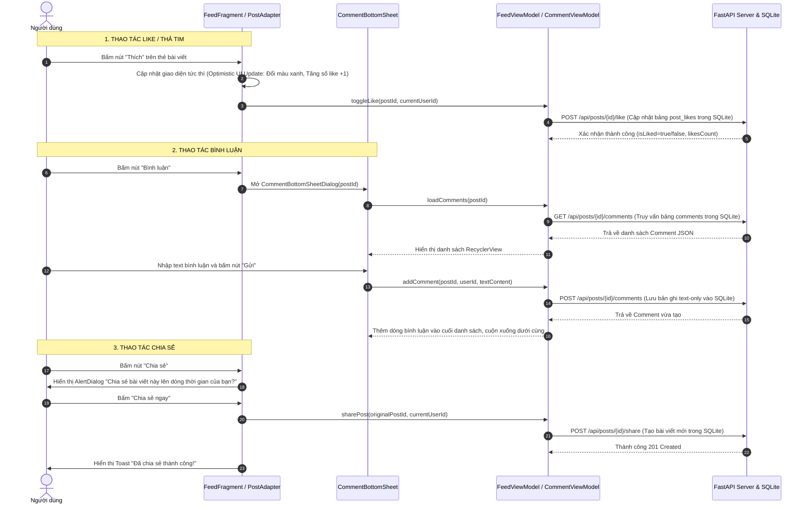
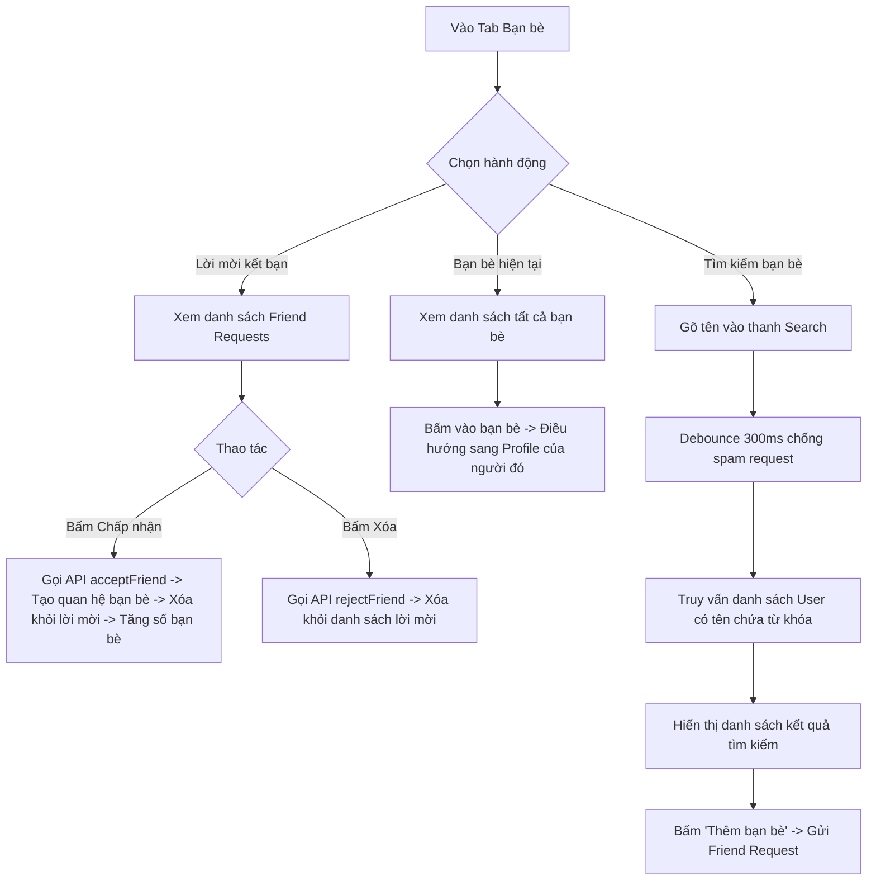
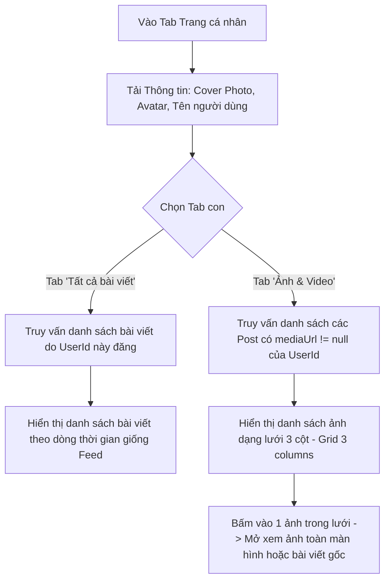

# 🔄 04. LUỒNG NGƯỜI DÙNG & TƯƠNG TÁC (USER FLOW)

---

## 1. SƠ ĐỒ ĐIỀU HƯỚNG TỔNG QUAN (APP NAVIGATION MAP)

---

## 2. LUỒNG NGHIỆP VỤ CHI TIẾT (DETAILED USER JOURNEYS)

### 2.1. Luồng Tạo bài viết mới (Create Post Flow)
Tuân thủ ràng buộc nghiêm ngặt từ `Mobile App.pdf`: Nút đăng chỉ sáng khi có chữ HOẶC có ảnh.

---

### 2.2. Luồng Tương tác Bài viết (Like, Comment, Share Flow)

---

### 2.3. Luồng Quản lý Bạn bè (Friend Tab Flow)

---

### 2.4. Luồng Trang cá nhân (Profile Flow)

