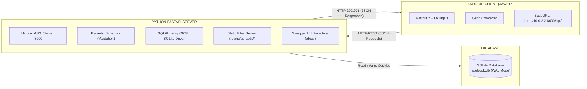
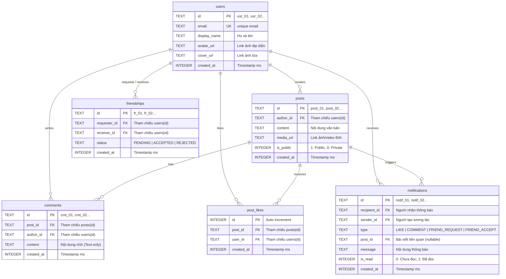

# 09. KIẾN TRÚC SERVER BACKEND (PYTHON FASTAPI) & CƠ SỞ DỮ LIỆU (SQLITE)

---

## 1. TỔNG QUAN GIẢI PHÁP BACKEND: PYTHON FASTAPI + SQLITE

Để đáp ứng tối đa tiêu chí của đồ án môn học đại học: **đơn giản, gọn nhẹ, hiệu năng cực cao và dễ dàng vận hành**, đội ngũ kỹ thuật quyết định lựa chọn kiến trúc Backend dựa trên **Python FastAPI** và **SQLite**:

### 1.1. Tại sao lựa chọn Python FastAPI?
- **Tốc độ & Hiệu năng cao (High Performance):** FastAPI được xây dựng trên nền tảng Starlette và Pydantic, là một trong những framework Python nhanh nhất hiện nay (ngang ngửa NodeJS và Go).
- **Tự động sinh tài liệu API (Auto-generated OpenAPI / Swagger UI):** Tự động tạo trang tài liệu kiểm thử trực quan tại `http://localhost:8000/docs` và `http://localhost:8000/redoc`. Giúp đội ngũ Frontend (Retrofit) đối chiếu dữ liệu JSON chuẩn xác 100% mà không sợ lệch hợp đồng (Contract Mismatch).
- **Xác thực dữ liệu chặt chẽ (Data Validation with Pydantic):** Tự động parse và validate kiểu dữ liệu của request body, query params, headers, loại bỏ tối đa lỗi kiểu dữ liệu.
- **Hỗ trợ Asynchronous (Async/Await):** Xử lý đồng thời hàng nghìn request I/O-bound mượt mà.
- **Dễ học, dễ viết:** Cú pháp Python ngắn gọn, dễ hiểu cho cả 7 thành viên.

### 1.2. Tại sao lựa chọn SQLite làm Cơ sở dữ liệu?
- **Zero-Configuration (Không cần cài đặt máy chủ CSDL phức tạp):** SQLite là hệ quản trị cơ sở dữ liệu quan hệ (RDBMS) dạng Serverless, toàn bộ dữ liệu được lưu gói gọn trong một file duy nhất (`facebook.db`). Không cần cài đặt MySQL, PostgreSQL hay Docker cồng kềnh.
- **Tương thích 100% SQL chuẩn:** Hỗ trợ đầy đủ các khóa chính (PK), khóa ngoại (FK), chỉ mục (INDEX), giao dịch ACID (Transactions).
- **Kích hoạt WAL Mode (Write-Ahead Logging):** Cho phép đồng thời nhiều tiến trình đọc (Read) trong khi tiến trình ghi (Write) đang diễn ra mà không bị lỗi `database is locked`.
- **Dễ dàng chia sẻ & Backup:** File database có thể dễ dàng sao chép, tạo bản seed data mẫu để nộp cho Giảng viên kiểm tra hoặc chạy demo mà không sợ chết máy chủ cloud.
- **Chi phí 0 VNĐ:** Chạy trực tiếp trên máy tính cá nhân (Localhost) hoặc deploy miễn phí lên các dịch vụ đám mây (Render, Fly.io, Railway, PythonAnywhere, Ngrok tunnel).

### 1.3. Mô hình Giao tiếp Client - Server (Android <-> FastAPI):



>[!IMPORTANT]
>**Lưu ý đặc biệt khi kết nối Android Emulator với Local Backend:**
>- Trên máy ảo Android Studio (Pixel 10a), địa chỉ `localhost` hay `127.0.2.1` đại diện cho chính máy ảo đó!
>- Để máy ảo Android gọi được server FastAPI đang chạy trên máy tính host, Base URL trong Retrofit phải là: **`http://10.0.2.2:8000/api/`**.
>- Nếu chạy bằng thiết bị thật qua Wi-Fi chung, thay `10.0.2.2` bằng địa chỉ IP LAN của máy tính host (ví dụ: `http://192.168.1.15:8000/api/`).

---

## 2. THIẾT KẾ CƠ SỞ DỮ LIỆU CHUẨN HÓA (SQLITE SCHEMA / ERD)

Toàn bộ hệ thống cơ sở dữ liệu quan hệ của Facebook Client được chuẩn hóa theo dạng 3NF, lưu trữ tại file `facebook.db`:



### 2.1. Mã DDL Tạo Bảng SQLite (`schema.sql`):
```sql
-- 1. Bảng Người dùng (users)
CREATE TABLE IF NOT EXISTS users (
    id TEXT PRIMARY KEY,
    email TEXT UNIQUE NOT NULL,
    display_name TEXT NOT NULL,
    avatar_url TEXT,
    cover_url TEXT,
    created_at INTEGER NOT NULL
);

-- 2. Bảng Bài viết (posts)
CREATE TABLE IF NOT EXISTS posts (
    id TEXT PRIMARY KEY,
    author_id TEXT NOT NULL,
    content TEXT,
    media_url TEXT,
    is_public INTEGER DEFAULT 1,
    created_at INTEGER NOT NULL,
    FOREIGN KEY (author_id) REFERENCES users(id) ON DELETE CASCADE
);

-- 3. Bảng Bình luận (comments - Text only theo đặc tả PDF)
CREATE TABLE IF NOT EXISTS comments (
    id TEXT PRIMARY KEY,
    post_id TEXT NOT NULL,
    author_id TEXT NOT NULL,
    content TEXT NOT NULL,
    created_at INTEGER NOT NULL,
    FOREIGN KEY (post_id) REFERENCES posts(id) ON DELETE CASCADE,
    FOREIGN KEY (author_id) REFERENCES users(id) ON DELETE CASCADE
);

-- 4. Bảng Lượt thích bài viết (post_likes)
CREATE TABLE IF NOT EXISTS post_likes (
    id INTEGER PRIMARY KEY AUTOINCREMENT,
    post_id TEXT NOT NULL,
    user_id TEXT NOT NULL,
    created_at INTEGER NOT NULL,
    UNIQUE(post_id, user_id),
    FOREIGN KEY (post_id) REFERENCES posts(id) ON DELETE CASCADE,
    FOREIGN KEY (user_id) REFERENCES users(id) ON DELETE CASCADE
);

-- 5. Bảng Quan hệ Bạn bè (friendships)
CREATE TABLE IF NOT EXISTS friendships (
    id TEXT PRIMARY KEY,
    requester_id TEXT NOT NULL,
    receiver_id TEXT NOT NULL,
    status TEXT CHECK(status IN ('PENDING', 'ACCEPTED', 'REJECTED')) NOT NULL,
    created_at INTEGER NOT NULL,
    UNIQUE(requester_id, receiver_id),
    FOREIGN KEY (requester_id) REFERENCES users(id) ON DELETE CASCADE,
    FOREIGN KEY (receiver_id) REFERENCES users(id) ON DELETE CASCADE
);

-- 6. Bảng Thông báo (notifications)
CREATE TABLE IF NOT EXISTS notifications (
    id TEXT PRIMARY KEY,
    recipient_id TEXT NOT NULL,
    sender_id TEXT NOT NULL,
    type TEXT CHECK(type IN ('LIKE', 'COMMENT', 'FRIEND_REQUEST', 'FRIEND_ACCEPT')) NOT NULL,
    post_id TEXT,
    message TEXT NOT NULL,
    is_read INTEGER DEFAULT 0,
    created_at INTEGER NOT NULL,
    FOREIGN KEY (recipient_id) REFERENCES users(id) ON DELETE CASCADE,
    FOREIGN KEY (sender_id) REFERENCES users(id) ON DELETE CASCADE,
    FOREIGN KEY (post_id) REFERENCES posts(id) ON DELETE SET NULL
);

-- Tối ưu hóa truy vấn với các Indexes
CREATE INDEX IF NOT EXISTS idx_posts_author ON posts(author_id, created_at DESC);
CREATE INDEX IF NOT EXISTS idx_posts_created ON posts(created_at DESC);
CREATE INDEX IF NOT EXISTS idx_comments_post ON comments(post_id, created_at ASC);
CREATE INDEX IF NOT EXISTS idx_likes_post ON post_likes(post_id);
CREATE INDEX IF NOT EXISTS idx_friendships_receiver ON friendships(receiver_id, status);
CREATE INDEX IF NOT EXISTS idx_notifications_recipient ON notifications(recipient_id, created_at DESC);
```

---

## 3. ĐẶC TẢ CHI TIẾT RESTFUL API CONTRACTS

Toàn bộ phản hồi API đều ở định dạng JSON tiêu chuẩn. Mã trạng thái HTTP:
- `200 OK`: Truy vấn / cập nhật thành công.
- `201 Created`: Tạo mới tài nguyên thành công.
- `400 Bad Request`: Dữ liệu đầu vào không hợp lệ (ví dụ: đăng bài rỗng).
- `404 Not Found`: Không tìm thấy dữ liệu.
- `422 Unprocessable Entity`: Dữ liệu đầu vào sai kiểu (Pydantic validation).
- `500 Internal Server Error`: Lỗi máy chủ.

### 3.1. Phân hệ Xác thực & Người dùng (Auth & Users)
| Phương thức | Endpoint | Mô tả |
|:--- |:--- |:--- |
| `GET` | `/api/users` | Lấy danh sách tài khoản demo |
| `GET` | `/api/users/{id}` | Lấy thông tin chi tiết một người dùng |
| `PUT` | `/api/users/{id}` | Cập nhật avatar_url, cover_url, display_name |

**Ví dụ JSON Response User (`GET /api/users/usr_01`):**
```json
{
  "id": "usr_01",
  "email": "tungduong@gmail.com",
  "displayName": "Tùng Dương",
  "avatarUrl": "http://10.0.2.2:8000/static/uploads/avatar_tungduong.jpg",
  "coverUrl": "http://10.0.2.2:8000/static/uploads/cover_tungduong.jpg",
  "createdAt": 1728500000000
}
```

---

### 3.2. Phân hệ Bảng tin & Đăng bài (Feed & Posts)
| Phương thức | Endpoint | Mô tả |
|:--- |:--- |:--- |
| `GET` | `/api/posts?limit=20&current_user_id={id}` | Lấy danh sách bài viết trên Feed (kèm cờ `isLiked`) |
| `POST` | `/api/posts` | Tạo bài viết mới |
| `POST` | `/api/posts/{id}/like` | Bật/tắt trạng thái Thích (Toggle Like) |
| `POST` | `/api/posts/{id}/share` | Chia sẻ bài viết lên tường nhà mình |
| `GET` | `/api/users/{id}/posts` | Lấy danh sách bài viết của một người dùng |
| `GET` | `/api/users/{id}/photos` | Lấy kho ảnh của người dùng (bài viết có `mediaUrl`) |

**Ví dụ Request Body Tạo bài viết (`POST /api/posts`):**
```json
{
  "authorId": "usr_01",
  "content": "Nhóm 7 người đã hoàn tất kết nối Android Retrofit với FastAPI và SQLite!",
  "mediaUrl": "http://10.0.2.2:8000/static/uploads/post_image_01.jpg",
  "isPublic": true
}
```

**Ví dụ Response Post Item:**
```json
{
  "id": "post_1001",
  "authorId": "usr_01",
  "authorName": "Tùng Dương",
  "authorAvatar": "http://10.0.2.2:8000/static/uploads/avatar_tungduong.jpg",
  "content": "Nhóm 7 người đã hoàn tất kết nối Android Retrofit với FastAPI và SQLite!",
  "mediaUrl": "http://10.0.2.2:8000/static/uploads/post_image_01.jpg",
  "isPublic": true,
  "likesCount": 15,
  "commentsCount": 3,
  "isLiked": false,
  "createdAt": 1728512345678
}
```

---

### 3.3. Phân hệ Bình luận (Comments - Text Only)
| Phương thức | Endpoint | Mô tả |
|:--- |:--- |:--- |
| `GET` | `/api/posts/{id}/comments` | Lấy danh sách bình luận của bài viết |
| `POST` | `/api/posts/{id}/comments` | Thêm bình luận văn bản mới (Text only) |

**Ví dụ Request Body Gửi bình luận (`POST /api/posts/post_1001/comments`):**
```json
{
  "authorId": "usr_02",
  "content": "Backend FastAPI chạy nhanh và mượt quá bạn ơi!"
}
```

---

### 3.4. Phân hệ Bạn bè (Friends & Search)
| Phương thức | Endpoint | Mô tả |
|:--- |:--- |:--- |
| `GET` | `/api/friends/requests?user_id={id}` | Lấy danh sách lời mời kết bạn gửi đến |
| `GET` | `/api/friends?user_id={id}` | Lấy danh sách bạn bè hiện tại |
| `POST` | `/api/friends/requests` | Gửi lời mời kết bạn |
| `POST` | `/api/friends/accept` | Chấp nhận lời mời kết bạn |
| `POST` | `/api/friends/reject` | Từ chối / Xóa lời mời kết bạn |
| `GET` | `/api/friends/search?q={keyword}&user_id={id}` | Tìm kiếm bạn bè theo tên |

---

### 3.5. Phân hệ Thông báo & Upload Media (Notifications & Upload)
| Phương thức | Endpoint | Mô tả |
|:--- |:--- |:--- |
| `GET` | `/api/notifications?user_id={id}` | Lấy danh sách thông báo của người dùng |
| `POST` | `/api/notifications/{id}/read` | Đánh dấu thông báo đã đọc |
| `POST` | `/api/upload` | Upload file ảnh (`multipart/form-data`) lưu vào thư mục `static/uploads/` |

---

## 4. MÃ NGUỒN TRIỂN KHAI HOÀN CHỈNH (PRODUCTION-READY PYTHON FASTAPI CODE)

### 4.1. Cấu hình Ứng dụng Chính (`backend/main.py`):
```python
import os
from fastapi import FastAPI, Request, status
from fastapi.middleware.cors import CORSMiddleware
from fastapi.staticfiles import StaticFiles
from fastapi.responses import JSONResponse
from fastapi.exceptions import RequestValidationError
from database import engine, Base
import models
from routers import auth, posts, comments, friends, profile, notifications, upload

# Tự động tạo bảng SQLite nếu chưa tồn tại
Base.metadata.create_all(bind=engine)

# Đảm bảo thư mục upload tĩnh tồn tại
os.makedirs("static/uploads", exist_ok=True)

app = FastAPI(
    title="Facebook Mobile Client Backend API",
    description="RESTful API cung cấp dữ liệu cho ứng dụng di động Facebook Client (Android Java)",
    version="1.0.0",
    docs_url="/docs",
    redoc_url="/redoc"
)

# Cấu hình CORS Middleware cho phép mọi client truy cập
app.add_middleware(
    CORSMiddleware,
    allow_origins=["*"],
    allow_credentials=True,
    allow_methods=["*"],
    allow_headers=["*"],
)

# Mount thư mục static phục vụ file ảnh
app.mount("/static", StaticFiles(directory="static"), name="static")

# Xử lý ngoại lệ Validation Pydantic đồng bộ JSON cho Android Retrofit
@app.exception_handler(RequestValidationError)
async def validation_exception_handler(request: Request, exc: RequestValidationError):
    error_msg = exc.errors()[0]["msg"] if exc.errors() else "Dữ liệu không hợp lệ"
    return JSONResponse(
        status_code=status.HTTP_422_UNPROCESSABLE_ENTITY,
        content={"detail": error_msg}
    )

# Đăng ký các Routers
app.include_router(auth.router, prefix="/api/auth", tags=["Authentication & Demo Users"])
app.include_router(posts.router, prefix="/api/posts", tags=["Feed & Posts"])
app.include_router(comments.router, prefix="/api/posts", tags=["Comments"])
app.include_router(friends.router, prefix="/api/friends", tags=["Friends & Search"])
app.include_router(profile.router, prefix="/api/users", tags=["Profile & Photos"])
app.include_router(notifications.router, prefix="/api/notifications", tags=["Notifications"])
app.include_router(upload.router, prefix="/api/upload", tags=["Media Upload"])

@app.get("/", tags=["Health Check"])
def health_check():
    return {"status": "healthy", "framework": "FastAPI", "database": "SQLite"}
```

---

### 4.2. Xử lý Nghiệp vụ Bài viết (`backend/crud/crud_post.py`):
```python
import uuid
import time
from sqlalchemy.orm import Session
from sqlalchemy import desc, func
import models
import schemas

def get_feed_posts(db: Session, current_user_id: str, limit: int = 20):
    posts = (
        db.query(models.Post)
.order_by(desc(models.Post.created_at))
.limit(limit)
.all()
    )
    result = []
    for p in posts:
        # Đếm số like
        likes_count = db.query(models.PostLike).filter(models.PostLike.post_id == p.id).count()
        # Đếm số comment
        comments_count = db.query(models.Comment).filter(models.Comment.post_id == p.id).count()
        # Kiểm tra user hiện tại đã like chưa
        is_liked = False
        if current_user_id:
            liked = db.query(models.PostLike).filter(
                models.PostLike.post_id == p.id,
                models.PostLike.user_id == current_user_id
            ).first()
            is_liked = liked is not None

        result.append(schemas.PostResponse(
            id=p.id,
            authorId=p.author.id,
            authorName=p.author.display_name,
            authorAvatar=p.author.avatar_url,
            content=p.content,
            mediaUrl=p.media_url,
            isPublic=p.is_public,
            likesCount=likes_count,
            commentsCount=comments_count,
            isLiked=is_liked,
            createdAt=p.created_at
        ))
    return result

def create_post(db: Session, post_data: schemas.PostCreate):
    post_id = f"post_{uuid.uuid4().hex[:8]}"
    db_post = models.Post(
        id=post_id,
        author_id=post_data.authorId,
        content=post_data.content,
        media_url=post_data.mediaUrl,
        is_public=post_data.isPublic,
        created_at=int(time.time() * 1000)
    )
    db.add(db_post)
    db.commit()
    db.refresh(db_post)
    return db_post

def toggle_like(db: Session, post_id: str, user_id: str):
    existing = db.query(models.PostLike).filter(
        models.PostLike.post_id == post_id,
        models.PostLike.user_id == user_id
    ).first()

    if existing:
        db.delete(existing)
        db.commit()
        is_liked = False
    else:
        new_like = models.PostLike(
            post_id=post_id,
            user_id=user_id,
            created_at=int(time.time() * 1000)
        )
        db.add(new_like)
        
        # Tạo thông báo cho chủ bài viết (nếu không phải tự like bài mình)
        post = db.query(models.Post).filter(models.Post.id == post_id).first()
        if post and post.author_id != user_id:
            liker = db.query(models.User).filter(models.User.id == user_id).first()
            sender_name = liker.display_name if liker else "Một người bạn"
            notif = models.Notification(
                id=f"notif_{uuid.uuid4().hex[:8]}",
                recipient_id=post.author_id,
                sender_id=user_id,
                type="LIKE",
                post_id=post_id,
                message=f"{sender_name} đã thích bài viết của bạn.",
                created_at=int(time.time() * 1000)
            )
            db.add(notif)
        db.commit()
        is_liked = True

    likes_count = db.query(models.PostLike).filter(models.PostLike.post_id == post_id).count()
    return {"isLiked": is_liked, "likesCount": likes_count}
```

---

### 4.3. Router Xử lý Upload Ảnh Tĩnh (`backend/routers/upload.py`):
```python
import os
import uuid
import aiofiles
from fastapi import APIRouter, UploadFile, File, HTTPException, status

router = APIRouter()
UPLOAD_DIR = "static/uploads"
ALLOWED_EXTENSIONS = {".jpg", ".jpeg", ".png", ".webp"}
MAX_FILE_SIZE = 5 * 1024 * 1024 # 5MB

@router.post("", status_code=status.HTTP_201_CREATED)
async def upload_image(file: UploadFile = File(...)):
    # 1. Kiểm tra phần mở rộng tệp tin
    _, ext = os.path.splitext(file.filename.lower())
    if ext not in ALLOWED_EXTENSIONS:
        raise HTTPException(
            status_code=status.HTTP_400_BAD_REQUEST, 
            detail="Định dạng tệp không hỗ trợ! Chỉ chấp nhận JPG, PNG, WEBP."
        )

    # 2. Đọc nội dung và kiểm tra kích thước
    content = await file.read()
    if len(content) > MAX_FILE_SIZE:
        raise HTTPException(
            status_code=status.HTTP_413_REQUEST_ENTITY_TOO_LARGE,
            detail="Kích thước tệp tin vượt quá 5MB!"
        )

    # 3. Tạo tên tệp ngẫu nhiên chống trùng lặp
    filename = f"img_{uuid.uuid4().hex[:12]}{ext}"
    filepath = os.path.join(UPLOAD_DIR, filename)

    # 4. Ghi tệp tin bất đồng bộ
    async with aiofiles.open(filepath, "wb") as out_file:
        await out_file.write(content)

    # 5. Trả về đường dẫn tĩnh có thể truy cập qua HTTP
    url = f"http://10.0.2.2:8000/static/uploads/{filename}"
    return {"url": url, "filename": filename}
```

---

### 4.4. Script Khởi tạo Dữ liệu Mẫu Phục vụ Demo (`backend/seed_data.py`):
Chạy script này một lần duy nhất trước khi bảo vệ đồ án để có sẵn tài khoản và bài viết trực quan:

```python
import time
from database import SessionLocal, engine, Base
import models

Base.metadata.create_all(bind=engine)
db = SessionLocal()

# Xóa dữ liệu cũ nếu muốn reset
db.query(models.Notification).delete()
db.query(models.Friendship).delete()
db.query(models.PostLike).delete()
db.query(models.Comment).delete()
db.query(models.Post).delete()
db.query(models.User).delete()
db.commit()

now = int(time.time() * 1000)

# 1. Tạo 3 tài khoản Demo chuẩn theo phân vai nhóm
user1 = models.User(
    id="usr_01",
    email="tungduong@gmail.com",
    display_name="Tùng Dương",
    avatar_url="https://images.unsplash.com/photo-1535713875002-d1d0cf377fde?w=200",
    cover_url="https://images.unsplash.com/photo-1579546929518-9e396f3cc809?w=800",
    created_at=now - 86400000 * 10
)
user2 = models.User(
    id="usr_02",
    email="minhluong@gmail.com",
    display_name="Minh Lương",
    avatar_url="https://images.unsplash.com/photo-1570295999919-56ceb5ecca61?w=200",
    cover_url="https://images.unsplash.com/photo-1507525428034-b723cf961d3e?w=800",
    created_at=now - 86400000 * 8
)
user3 = models.User(
    id="usr_03",
    email="anhduong@gmail.com",
    display_name="Ánh Dương",
    avatar_url="https://images.unsplash.com/photo-1494790108377-be9c29b29330?w=200",
    cover_url="https://images.unsplash.com/photo-1519681393784-d120267933ba?w=800",
    created_at=now - 86400000 * 5
)
db.add_all([user1, user2, user3])
db.commit()

# 2. Tạo bài viết mẫu
post1 = models.Post(
    id="post_01",
    author_id="usr_01",
    content="Chào mừng các bạn đến với ứng dụng Facebook Mobile Client của nhóm 7 người!",
    media_url="https://images.unsplash.com/photo-1618005182384-a83a8bd57fbe?w=800",
    created_at=now - 3600000 * 2
)
post2 = models.Post(
    id="post_02",
    author_id="usr_02",
    content="Hôm nay thời tiết thật đẹp, nhóm chúng mình vừa tích hợp thành công Retrofit với FastAPI và SQLite!",
    media_url=None,
    created_at=now - 3600000
)
db.add_all([post1, post2])
db.commit()

# 3. Tạo bình luận mẫu (Text only)
cmt1 = models.Comment(
    id="cmt_01",
    post_id="post_01",
    author_id="usr_02",
    content="Tuyệt vời quá Dương ơi, giao diện chạy mượt mà trên máy ảo Pixel 10a!",
    created_at=now - 1800000
)
db.add(cmt1)

# 4. Tạo quan hệ bạn bè mẫu
frnd = models.Friendship(
    id="frnd_01",
    requester_id="usr_03",
    receiver_id="usr_01",
    status="PENDING",
    created_at=now - 1200000
)
db.add(frnd)
db.commit()
db.close()
print(" Đã khởi tạo thành công dữ liệu mẫu vào facebook.db!")
```

---

## 5. HƯỚNG DẪN CÀI ĐẶT & CHẠY SERVER NHANH TRONG 3 BƯỚC

1. **Di chuyển vào thư mục backend:**
   ```bash
   cd backend
   ```
2. **Khởi tạo và kích hoạt môi trường ảo Python:**
   ```bash
   python -m venv venv
   # Windows PowerShell:
.\venv\Scripts\Activate.ps1
   # Cài đặt thư viện:
   pip install -r requirements.txt
   ```
3. **Chèn dữ liệu mẫu & Chạy máy chủ:**
   ```bash
   python seed_data.py
   uvicorn main:app --reload --host 0.0.0.0 --port 8000
   ```
4. **Kiểm tra kết quả:**
   - Mở trình duyệt tại `http://localhost:8000/docs` (Swagger UI).
   - Máy ảo Pixel 10a Android kết nối trực tiếp qua `http://10.0.2.2:8000/api/posts`.
