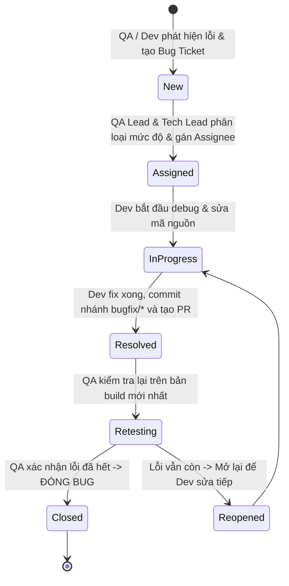

# 🐛 11. QUY TRÌNH QUẢN LÝ VÀ XỬ LÝ LỖI (BUG TRIAGE & RESOLUTION PROTOCOL)

---

## 1. MỤC TIÊU & NGUYÊN TẮC (CORE PRINCIPLES)

> [!IMPORTANT]
> **Nguyên tắc "Lỗi của ai - Người đó fix":**  
> Tuyệt đối không đùn đẩy trách nhiệm. Bất kỳ lỗi nào phát sinh đều phải được định danh chính xác nguyên nhân gốc rễ (Root Cause) xuất phát từ tầng Giao diện (Frontend) hay tầng Dữ liệu/Hệ thống (Backend) để gán đúng lập trình viên phụ trách module đó giải quyết.

---

## 2. VÒNG ĐỜI CỦA MỘT LỖI (BUG LIFECYCLE)



### Các bước cụ thể:
1. **Phát hiện & Ghi nhận (New):** Bất kỳ ai thấy lỗi (đặc biệt là 2 bạn QA: Hà Đăng Huy, Tạ Quang Huy) đều tạo Issue trên GitHub hoặc gửi vào kênh chat nhóm theo mẫu báo lỗi chuẩn.
2. **Phân loại & Gán việc (Assigned):** QA Lead và Tech Lead xác định mức độ nghiêm trọng (Severity) và phân công chính xác người fix.
3. **Sửa lỗi (In Progress -> Resolved):** Dev tạo nhánh `bugfix/<ten-loi>-<bug-id>`, sửa lỗi, kiểm tra tại máy, tạo PR và merge vào `develop`.
4. **Kiểm thử lại (Retesting -> Closed):** QA lấy code mới nhất về máy ảo, thực hiện lại đúng các bước gây lỗi trước đó. Nếu đã hoạt động chuẩn thì đóng Bug (Closed).

---

## 3. PHÂN ĐỊNH MỨC ĐỘ NGHIÊM TRỌNG (BUG SEVERITY LEVELS)

| Cấp độ | Tên mức độ | Mô tả hiện tượng | Thời gian xử lý tối đa (SLA) |
| :---: | :--- | :--- | :---: |
| **P0** | **Blocker** | Ứng dụng bị văng (Crash App), dừng đột ngột (ANR), hoặc không thể đăng nhập vào ứng dụng. Chặn toàn bộ việc kiểm thử các tính năng khác. | **Fix ngay trong 4 giờ** |
| **P1** | **Critical** | Tính năng cốt lõi bị hỏng: Không thể đăng bài, bấm like nhưng không lưu vào DB, không xem được danh sách bạn bè. | **Fix trong vòng 24 giờ** |
| **P2** | **Major** | Tính năng chạy được nhưng sai nghiệp vụ: Đăng bài khi cả text và ảnh đều rỗng, số like hiển thị sai sau khi cuộn trang, avatar bị méo tỷ lệ. | **Fix trong vòng 48 giờ** |
| **P3** | **Minor / Trivial** | Lỗi hiển thị nhỏ: Sai màu sắc một icon, lỗi chính tả chữ tiếng Việt, khoảng cách padding bị lệch vài dp. | **Fix trước ngày đóng Sprint** |

---

## 4. MA TRẬN PHÂN ĐỊNH TRÁCH NHIỆM: AI FIX LỖI GÌ? (RACI MATRIX)

Khi có lỗi xảy ra, đối chiếu bảng dưới đây để biết chính xác người có trách nhiệm sửa lỗi:

| Loại lỗi phát sinh | Dấu hiệu nhận biết trong Logcat / UI | Thành viên chịu trách nhiệm Fix |
| :--- | :--- | :--- |
| **Lỗi Form Tạo bài viết** | Bấm nút Đăng không phản hồi, cho phép đăng bài rỗng, nút chọn ảnh bị đơ | **Tùng Dương** (FE Lead) |
| **Lỗi Shell / Navigation** | Bấm chuyển các Tab đáy bị lag, thanh Header trên cùng bị che khuất | **Tùng Dương** (FE Lead) |
| **Lỗi Bảng tin (Feed)** | RecyclerView cuộn bị giật lag, hiển thị trùng bài viết, sai định dạng ngày giờ | **Minh Lương** (FE) |
| **Lỗi Tương tác Like/Share** | Bấm like nhưng nút không đổi màu, bấm Share không hiện popup xác nhận | **Minh Lương** (FE) |
| **Lỗi Bình luận (Comment)** | Hộp thoại comment không mở được, danh sách comment không cuộn xuống đáy | **Minh Lương** (FE) |
| **Lỗi Bạn bè & Tìm kiếm** | Bấm tìm kiếm không hiện kết quả, nút Đồng ý kết bạn không cập nhật UI | **Phúc Đức** (FE) |
| **Lỗi Trang cá nhân (Profile)** | Ảnh bìa bị vỡ, Tab ảnh lưới 3 cột không hiển thị đủ ảnh | **Phúc Đức** (FE) & **Tạ Quang Huy** |
| **Lỗi Thông báo (Notification)** | Bấm vào thông báo không nhảy sang đúng bài viết | **Tạ Quang Huy** (FE/QA) |
| **Lỗi Cloud Storage / Tải ảnh** | Tải ảnh lên báo lỗi 403 Forbidden, đường link ảnh trả về bị hỏng | **Minh Đức** (BE) |
| **Lỗi Dữ liệu Feed & DB** | Firestore báo lỗi Permission Denied, dữ liệu bài viết không lưu vào DB | **Ánh Dương** (BE Lead) |
| **Lỗi API Quan hệ Bạn bè** | Gọi API kết bạn bị lỗi trùng lặp dữ liệu, không xóa được lời mời | **Hà Đăng Huy** (BE/QA) |
| **Lỗi Lệch Hợp đồng (Contract Mismatch)** | Tên trường JSON trên Backend khác với tên trường trong Model Java của Frontend | **Ánh Dương (BE) + Tùng Dương (FE)** cùng ngồi sửa lại DTO |

---

## 5. MẪU BÁO CÁO LỖI CHUẨN (BUG REPORT TEMPLATE)

Khi phát hiện lỗi, người báo cáo (thường là Hà Đăng Huy hoặc Tạ Quang Huy) phải tạo ticket theo mẫu sau:

```markdown
### [BUG-ID] Tiêu đề ngắn gọn mô tả lỗi
- **Module:** Feed / Friends / Profile / CreatePost / Notifications
- **Mức độ (Severity):** P0 / P1 / P2 / P3
- **Người được gán (Assignee):** [Tên thành viên theo Ma trận phân định]

#### 1. Các bước tái hiện lỗi (Steps to Reproduce):
1. Mở ứng dụng, đăng nhập tài khoản A.
2. Bấm vào khung "Bạn đang nghĩ gì?" để mở màn hình Tạo bài viết.
3. Không nhập bất kỳ ký tự nào, không chọn ảnh.
4. Bấm vào nút "ĐĂNG" ở góc trên bên phải.

#### 2. Kết quả thực tế (Actual Result):
- Ứng dụng vẫn cho phép gửi yêu cầu và tạo ra một bài viết trắng trơn trên bảng tin.

#### 3. Kết quả mong đợi (Expected Result):
- Nút "ĐĂNG" phải bị vô hiệu hóa (disabled), không cho phép người dùng bấm nếu chưa có nội dung.

#### 4. Môi trường & Bằng chứng (Environment & Proof):
- Máy ảo: Google Pixel 10a (API 34).
- Ảnh chụp màn hình / Video đính kèm: [Link ảnh screenshot]
- Trích xuất Logcat (nếu có crash): NullPointerException at CreatePostActivity.java:45
```

---

## 6. QUY TRÌNH XỬ LÝ SỰ CỐ KHẨN CẤP TRƯỚC GIỜ BẢO VỆ (HOTFIX FLOW)

Nếu phát hiện lỗi nghiêm trọng (P0) trong vòng 24 giờ trước buổi bảo vệ đồ án:
1. Tất cả mọi thành viên dừng code tính năng mới ngay lập tức.
2. Tech Lead (Ánh Dương & Tùng Dương) bật chế độ **Code Freeze** (Đóng băng code).
3. Tạo nhánh trực tiếp từ `master`: `hotfix/critical-crash-fix`.
4. Dev phụ trách và Lead cùng Pair Programming sửa trực tiếp trên nhánh hotfix.
5. QA kiểm tra tại chỗ trên máy ảo demo.
6. Merge thẳng vào `master` và `develop`, tạo ngay bản APK phát hành cuối cùng.
