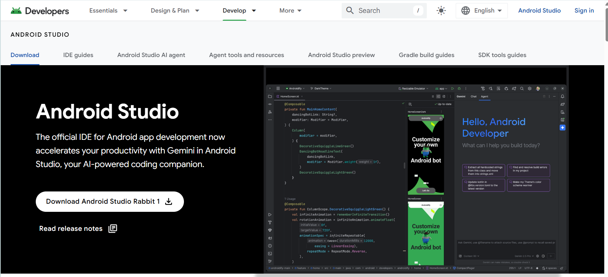
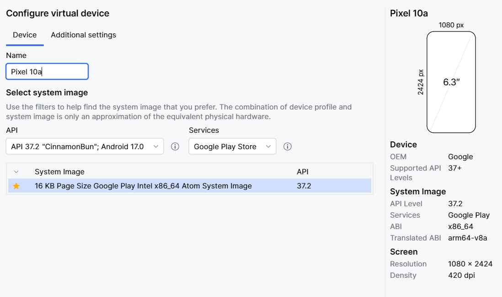
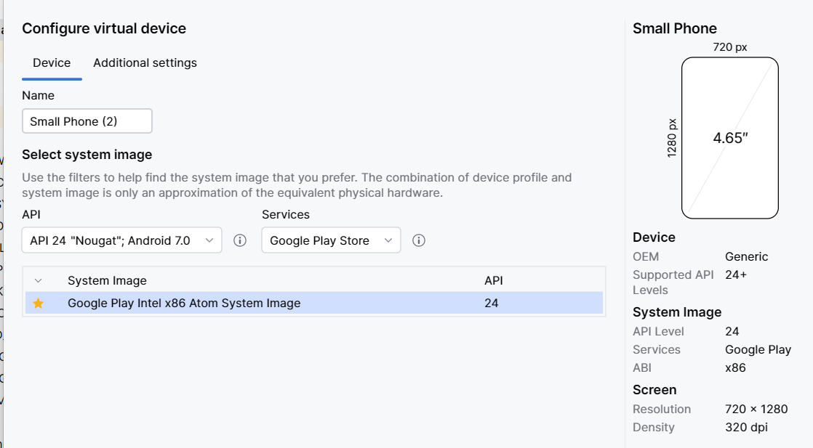

# 💻 12. HƯỚNG DẪN CÀI ĐẶT JAVA 17, CLONE GITHUB, SETUP PACKAGE & MÁY ẢO PIXEL 10A

---

## 1. THỐNG NHẤT BỘ THÔNG SỐ CHUẨN (MANDATORY PROJECT SPECS)

Toàn bộ 7 thành viên bắt buộc phải cấu hình chính xác và đồng nhất 100% các thông số sau:

| Thông số kỹ thuật | Giá trị chuẩn bắt buộc | Ý nghĩa kỹ thuật |
| :--- | :--- | :--- |
| **JDK (Java Version)** | **Java 17 LTS (JavaVersion.VERSION_17)** | Phiên bản chuẩn dài hạn, tránh lỗi tương thích AGP |
| **Android Studio** | **Bản mới nhất "Rabbit 1" (2026) - hỗ trợ AGP 9.4+ / Android 17** | Bắt buộc để build được SDK 37 |
| **Package Name / Namespace** | `com.facebook.client` | Định danh gói ứng dụng |
| **compileSdk** | **37** (Android 17.0) | Phiên bản SDK dùng để biên dịch |
| **targetSdk** | **37** (Android 17.0) | Phiên bản hệ điều hành mục tiêu |
| **minSdk** | **24** (Android 7.0 Nougat) | Đảm bảo tương thích 95%+ thiết bị thực tế |
| **Thiết bị máy ảo AVD** | **Pixel 10a (API Level 37.2 - CinnamonBun)** | Màn hình 6.3", 1080x2424, 420 dpi |
| **Build Tool & AGP** | Gradle 9.6 & Android Gradle Plugin (AGP) 9.4+ | Hệ thống build |
| **Backend Framework** | **Python 3.10+ (FastAPI + Uvicorn ASGI Server)** | RESTful API server tốc độ cao, Swagger UI |
| **Cơ sở dữ liệu** | **SQLite (facebook.db, SQLAlchemy ORM)** | CSDL quan hệ serverless không cần cài đặt |
| **Base URL cho Emulator** | `http://10.0.2.2:8000/api/` | Địa chỉ kết nối máy ảo Android tới Backend host |

> 📌 **Lưu ý phiên bản SDK:** Máy ảo là bản **API 37.2** (bản minor của Android 17.0), nhưng trong `build.gradle` chỉ ghi số nguyên **37** (`compileSdk 37`, `targetSdk 37`).

---

## 2. HƯỚNG DẪN CÀI ĐẶT ĐÚNG PHIÊN BẢN JAVA 17 (TỪNG BƯỚC)

### Bước 2.1: Kiểm tra phiên bản Java hiện tại trên máy tính
Mở **Command Prompt (cmd)** hoặc **PowerShell** trên Windows (hoặc Terminal trên macOS), gõ lệnh:
```bash
java --version
```
- Nếu hiển thị: `openjdk version "17.x.x"` hoặc `java version "17.x.x"` -> Máy đã có Java 17 chuẩn.
- Nếu hiển thị phiên bản khác (Java 8, 11, 21...) hoặc báo `command not found` -> Bắt buộc thực hiện bước 2.2 để cài Java 17.

### Bước 2.2: Tải và Cài đặt JDK 17 LTS
1. Truy cập trang tải chính thức của Eclipse Temurin (OpenJDK 17 được Google khuyến nghị):  
   🔗 https://adoptium.net/temurin/releases/?version=17  
   *(Hoặc tải Oracle JDK 17 tại: https://www.oracle.com/java/technologies/downloads/#java17)*
2. Chọn hệ điều hành: **Windows x64** -> Tải file cài đặt `.msi` (ví dụ: `OpenJDK17U-jdk_x64_windows_hotspot_17.0.10_7.msi`).
3. Chạy file installer:
   - Tích chọn: **"Set JAVA_HOME variable"** và **"Add to PATH"**.
   - Bấm **Next** và **Finish** để cài đặt.

### Bước 2.3: Thiết lập biến môi trường JAVA_HOME trên Windows (Nếu chưa tự động nhận)
1. Bấm phím `Windows`, gõ tìm kiếm: `Edit the system environment variables` -> Bấm Enter.
2. Bấm vào nút **Environment Variables...**.
3. Tại ô **System variables** (phía dưới):
   - Bấm **New...**:
     - Variable name: `JAVA_HOME`
     - Variable value: `C:\Program Files\Eclipse Adoptium\jdk-17.0.x-hotspot\` (hoặc thư mục cài đặt Java 17 thực tế).
4. Chọn biến **Path** -> Bấm **Edit...** -> Bấm **New** -> Thêm `%JAVA_HOME%\bin` -> Đưa lên trên đầu.
5. Mở lại một cửa sổ PowerShell mới, gõ `java -version` để xác nhận kết quả:
   ```text
   openjdk version "17.0.10" 2024-01-16
   OpenJDK Runtime Environment Temurin-17.0.10+7 (build 17.0.10+7)
   OpenJDK 64-Bit Server VM Temurin-17.0.10+7 (build 17.0.10+7, mixed mode, sharing)
   ```

---

## 3. HƯỚNG DẪN CÀI ĐẶT GIT & CLONE REPO TỪ GITHUB

### Bước 3.1: Cài đặt Git (nếu máy chưa có)
1. Tải Git tại: https://git-scm.com/download/win.
2. Cài đặt với các thiết lập mặc định.
3. Thiết lập thông tin cá nhân của bạn trong Git (Bắt buộc để chấm điểm đóng góp đồ án):
   ```bash
   git config --global user.name "Nguyen Van A"
   git config --global user.email "nguyenvana@gmail.com"
   ```

### Bước 3.2: Clone Repository về máy tính
1. Mở PowerShell hoặc Git Bash, di chuyển tới ổ đĩa làm việc (ví dụ `D:\LT`):
   ```bash
   cd D:\LT
   ```
2. Thực hiện lệnh Clone:
   ```bash
   git clone https://github.com/<duong-dan-repo-nhom>/Facebook_Client.git
   cd Facebook_Client
   ```

---

## 4. CÀI ANDROID STUDIO, MỞ DỰ ÁN & CẤU HÌNH GRADLE JDK 17

### Bước 4.1: Tải và cài đặt Android Studio (bản mới nhất "Rabbit 1")
1. Truy cập trang tải chính thức: https://developer.android.com/studio
2. Bấm nút **Download Android Studio Rabbit 1** -> tải file cài đặt `.exe` và cài với các tùy chọn mặc định (Next -> Next -> Finish).



> ⚠️ **Bắt buộc dùng bản Android Studio mới nhất (Rabbit 1 trở lên):** các bản cũ như Jellyfish, Koala... **không build được** `compileSdk 37` (Android 17).

### Bước 4.2: Mở dự án & cấu hình Gradle JDK 17

1. Khởi động **Android Studio**.
2. Trên màn hình chào mừng, chọn **Open** (hoặc thanh menu `File -> Open`).
3. Trỏ tới thư mục `Facebook_Client` vừa clone.
4. Chờ Android Studio load dự án.
5. **CẤU HÌNH GRADLE DÙNG ĐÚNG JDK 17 (BẮT BUỘC):**
   - Vào menu: `File -> Settings` (trên Windows) hoặc `Android Studio -> Settings` (trên macOS).
   - Tìm kiếm: **Gradle** (nằm tại mục `Build, Execution, Deployment -> Build Tools -> Gradle`).
   - Tại dòng **Gradle JDK**: Bấm vào menu thả xuống và chọn:
     - **Embedded JDK 17** (hoặc **jbr-17** có sẵn của Android Studio).
     - Hoặc chọn **Add JDK...** rồi trỏ tới thư mục Java 17 vừa cài ở Bước 2.
   - Bấm **Apply** -> **OK**.

---

## 5. THIẾT LẬP CẤU HÌNH GRADLE & SETUP CẤU TRÚC PACKAGE

> ✅ **LƯU Ý QUAN TRỌNG:** Dự án Android Gradle và cấu trúc Package bên dưới **đã được khởi tạo sẵn** trên nhánh `develop`.  
> Sau khi `git clone`, các thành viên nhóm **không cần tự tạo hay cấu hình lại từ đầu**. Bạn chỉ cần mở dự án trong Android Studio, kiểm tra cấu hình Gradle JDK 17 (ở Bước 4.2) và bắt đầu làm task.

### 5.1. File cấu hình chuẩn: `app/build.gradle`
File `app/build.gradle` phải khai báo đúng các thông số đồng nhất:

```groovy
plugins {
    id 'com.android.application'
}

android {
    namespace 'com.facebook.client'
    compileSdk 37

    defaultConfig {
        applicationId "com.facebook.client"
        minSdk 24
        targetSdk 37
        versionCode 1
        versionName "1.0"

        testInstrumentationRunner "androidx.test.runner.AndroidJUnitRunner"
    }

    buildTypes {
        release {
            minifyEnabled false
            proguardFiles getDefaultProguardFile('proguard-android-optimize.txt'), 'proguard-rules.pro'
        }
    }

    compileOptions {
        sourceCompatibility JavaVersion.VERSION_17
        targetCompatibility JavaVersion.VERSION_17
    }

    buildFeatures {
        viewBinding true
    }
}

dependencies {
    // Android Jetpack & Material Components
    implementation 'androidx.appcompat:appcompat:1.6.1'
    implementation 'com.google.android.material:material:1.11.0'
    implementation 'androidx.constraintlayout:constraintlayout:2.1.4'
    implementation 'androidx.lifecycle:lifecycle-viewmodel:2.7.0'
    implementation 'androidx.lifecycle:lifecycle-livedata:2.7.0'

    // Kết nối RESTful API (Retrofit 2 & OkHttp)
    implementation 'com.squareup.retrofit2:retrofit:2.9.0'
    implementation 'com.squareup.retrofit2:converter-gson:2.9.0'
    implementation 'com.squareup.okhttp3:logging-interceptor:4.12.0'

    // Tải và hiển thị hình ảnh
    implementation 'com.github.bumptech.glide:glide:4.16.0'
    annotationProcessor 'com.github.bumptech.glide:compiler:4.16.0'

    // Unit Testing
    testImplementation 'junit:junit:4.13.2'
    testImplementation 'org.mockito:mockito-core:5.11.0'
    testImplementation 'androidx.arch.core:core-testing:2.2.0'
}
```

> ⚠️ **Lưu ý Android 17 (API 37):** Từ Android 15+, ứng dụng mặc định vẽ tràn viền (**edge-to-edge**).
> Hãy dùng `Toolbar`/`AppBarLayout` và `BottomNavigationView` của **Material Components** (tự động xử lý insets),
> hoặc thêm `android:fitsSystemWindows="true"` cho layout gốc để nội dung không bị đè lên thanh trạng thái.

### 5.2. Khởi tạo cấu trúc Package chuẩn trong thư mục mã nguồn
Cả 7 thành viên phải thống nhất cấu trúc Package nằm dưới `com.facebook.client`:

```
app/src/main/java/com/facebook/client/
├── core/
│   ├── base/           (BaseActivity.java, BaseFragment.java)
│   ├── utils/          (PostValidator.java, DateUtils.java)
│   ├── common/         (Resource.java, Constants.java)
│   └── network/        (ApiClient.java, ApiService.java, ApiResponseHandler.java)
├── data/
│   ├── model/          (User.java, Post.java, Comment.java, Notification.java)
│   └── repository/     (IPostRepository.java, PostRepositoryImpl.java, MockPostRepository.java)
├── features/
│   ├── auth/           (LoginActivity.java, AuthViewModel.java)
│   ├── feed/           (FeedFragment.java, CreatePostActivity.java, FeedViewModel.java)
│   ├── comment/        (CommentBottomSheetDialog.java, CommentViewModel.java)
│   ├── friends/        (FriendsFragment.java, SearchFriendsActivity.java, FriendsViewModel.java)
│   ├── notifications/  (NotificationsFragment.java, NotificationViewModel.java)
│   └── profile/        (ProfileFragment.java, ProfileViewModel.java)
└── MainActivity.java   (Chứa BottomNavigationView điều hướng 4 Tab)
```

---

## 6. HƯỚNG DẪN TẠO MÁY ẢO LINH HOẠT THEO CẤU HÌNH MÁY TÍNH

Để phù hợp với cấu hình phần cứng khác nhau của từng thành viên, nhóm thống nhất 2 phương án chọn máy ảo:

### 🌟 Lựa chọn A: Pixel 10a (API 37.2) — Dành cho máy tính khỏe (RAM 16GB+)
Đây là cấu hình chuẩn chính thức của dự án để quay video demo và chụp ảnh báo cáo:
- **Profile:** Pixel 10a (`1080 x 2424`, `420 dpi`)
- **System Image:** API 37.2 (Android 17.0) — `16 KB Page Size Google Play Intel x86_64 Atom System Image`
- **RAM:** `4096 MB`



---

### ⚡ Lựa chọn B: Small Phone (API 24) — Dành cho máy tính yếu / vừa (RAM 8GB)
Dành cho thành viên cần tối ưu hiệu năng, giảm ngốn CPU/RAM:
- **Profile:** Small Phone (`720 x 1280`, `320 dpi`)
- **System Image:** API 24 (Android 7.0)— `Google Play Intel x86 Atom System Image`
- **RAM:** `1536 MB`
- **Graphics:** `Hardware - GLES 2.0`



> 📌 **Lưu ý:** Cả 2 lựa chọn máy ảo đều hoàn toàn tương thích với mã nguồn dự án (`minSdk 24`). Các thành viên có thể dùng song song các loại máy ảo khác nhau mà không ảnh hưởng tới code chung trên Git.

---

### Các bước tạo máy ảo trong Device Manager:
1. Mở Android Studio, vào menu: **Tools -> Device Manager** (hoặc icon điện thoại ở góc trên bên phải).
2. Bấm nút **Create Device** (dấu cộng `+`).
3. Chọn Hardware Profile (**Pixel 10a** cho Lựa chọn A hoặc **Small Phone** cho Lựa chọn B) -> Bấm **Next**.
4. Chọn System Image (API 37.2 cho Lựa chọn A hoặc API 24/30 cho Lựa chọn B) -> Bấm **Next**.
5. Trong **Show Advanced Settings**:
   - Chỉnh RAM (`4096 MB` cho Lựa chọn A, `1536 MB` cho Lựa chọn B).
   - Graphics: Chọn **Hardware - GLES 2.0**.
6. Bấm **Finish** và bấm nút **Play (▶️)** để khởi động máy ảo.

---

## 7. QUY TRÌNH BẮT ĐẦU LÀM MỘT TASK THỰC TẾ (WORKFLOW TO CODE)

Mỗi khi bạn được phân công một Task (theo bảng phân công tại [06_TASKS_SPRINT_PLAN.md](./06_TASKS_SPRINT_PLAN.md)):

```bash
# 1. Cập nhật mã nguồn mới nhất từ nhánh develop
git checkout develop
git pull origin develop

# 2. Tạo nhánh mới cho task của bạn
git checkout -b feature/feed-ui-TSK-10

# 3. Mở Android Studio và thực hiện code (Java, XML)
# 4. Chạy thử nghiệm trên máy ảo Pixel_10a_API_37 (Nhấn Shift + F10)
# 5. Chạy kiểm tra Unit Test trong Terminal
./gradlew testDebugUnitTest

# 6. Commit các thay đổi với thông điệp rõ ràng
git add .
git commit -m "feat(feed): implement PostAdapter and bind post layout (TSK-10)"

# 7. Đồng bộ trước khi đẩy code lên GitHub
git fetch origin
git merge origin/develop

# 8. Đẩy nhánh lên GitHub
git push origin feature/feed-ui-TSK-10

# 9. Truy cập GitHub tạo Pull Request (PR) vào nhánh develop và gán Reviewer duyệt!
```

---

## 8. HƯỚNG DẪN CÀI ĐẶT & KHỞI CHẠY BACKEND PYTHON FASTAPI + SQLITE

Dành cho cả 7 thành viên khi cần chạy Backend nội bộ để kiểm thử tích hợp (Integration Test) hoặc chấm điểm đồ án:

### Bước 8.1: Kiểm tra Python trên máy tính
Mở PowerShell hoặc Terminal, kiểm tra:
```bash
python --version
```
- Nếu hiển thị: `Python 3.10.x` trở lên -> Đã đạt yêu cầu.
- Nếu chưa có Python: Tải và cài đặt Python 3.10+ từ https://www.python.org/downloads/ (Nhớ tích chọn **"Add python.exe to PATH"** khi cài đặt).

### Bước 8.2: Tạo môi trường ảo & Cài đặt thư viện
Di chuyển vào thư mục `backend/` trong repo dự án:
```bash
cd backend
python -m venv venv

# Kích hoạt môi trường ảo (Windows PowerShell):
.\venv\Scripts\Activate.ps1
# (Nếu báo lỗi script execution policy trên PowerShell, chạy lệnh: Set-ExecutionPolicy -Scope Process -ExecutionPolicy Bypass)

# Hoặc kích hoạt trên Command Prompt (cmd):
venv\Scripts\activate.bat

# Kích hoạt trên macOS / Linux:
source venv/bin/activate
```

Cài đặt các gói phụ thuộc từ `requirements.txt`:
```bash
pip install -r requirements.txt
```

### Bước 8.3: Khởi chạy máy chủ FastAPI với Uvicorn
```bash
uvicorn main:app --reload --host 0.0.0.0 --port 8000
```
- Khi chạy thành công, terminal sẽ thông báo:
  ```text
  INFO:     Uvicorn running on http://0.0.0.0:8000 (Press CTRL+C to quit)
  INFO:     Started reloader process
  INFO:     Application startup complete.
  ```

### Bước 8.4: Kiểm tra Swagger UI & Kết nối Android Studio
1. **Kiểm tra trên trình duyệt máy tính:**  
   Truy cập `http://localhost:8000/docs` để xem giao diện tài liệu OpenAPI Swagger UI và thử nghiệm các API.
2. **Quy tắc địa chỉ IP cho Android Studio Emulator:**
   - Trong code Retrofit Android (`ApiClient.java`), Base URL bắt buộc là:  
     `public static final String BASE_URL = "http://10.0.2.2:8000/api/";`
   - Vì trên máy ảo Android, `10.0.2.2` là alias đặc biệt trỏ thẳng về `127.0.0.1` của máy tính host.
   - Thư mục tĩnh lưu ảnh tải lên: `http://10.0.2.2:8000/static/uploads/`.

